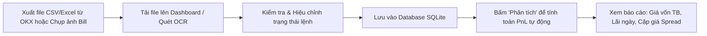

# 🟠 OKX P2P Profit Bot ("Trade U")

> **Hệ thống kế toán định lượng, phân tích tỷ suất sinh lời và quản lý chênh lệch giá (Spread Arbitrage) chuyên biệt cho thương nhân P2P (Merchant) sàn OKX.**

---

## 📌 Tổng Quan Dự Án

**OKX P2P Profit Bot** (thường gọi là **Trade U**) là nền tảng quản trị và tính toán lãi/lỗ dành riêng cho các nhà kinh doanh chênh lệch tỷ giá USDT/VND trên thị trường P2P OKX. Dự án giải quyết trọn vẹn bài toán nhức nhối của các Merchant P2P:
- **Tốc độ giao dịch dồn dập**: Hàng chục đến hàng trăm giao dịch nạp/rút, mua/bán diễn ra liên tục trong ngày với nhiều mức giá khác nhau.
- **Biến động giá vốn liên tục**: Giá nhập USDT thay đổi theo từng phút, khiến việc xác định chính xác giá vốn (Cost Basis) và lợi nhuận ròng của từng lệnh bán trở nên phức tạp nếu tính thủ công.
- **Rủi ro sai lệch dữ liệu**: Nhập nhầm giá, sót lệnh, hoặc lệnh bán diễn ra trước khi lệnh mua được ghi nhận.

Nền tảng tích hợp công nghệ **OCR thị giác máy tính**, bộ phân tích tệp dữ liệu sàn **Excel/CSV tự động**, thuật toán khớp lệnh **Rolling FIFO / Average Cost Basis chu kỳ**, cùng giao diện **Streamlit Web Dashboard** trực quan, giúp Merchant nắm bắt ngay lập tức:
- **Giá mua trung bình vòng hiện tại** (đang áp dụng cho các lệnh bán ra).
- **Lãi ròng từng lệnh bán** và chênh lệch spread VND/USDT.
- **Báo cáo PnL tổng kết theo từng ngày** và theo từng cặp giá (Spread Pairs).

---

## 🖼️ Giao Diện Điều Hành (Operator Web Dashboard)

Giao diện vận hành Streamlit được thiết kế tinh gọn, trực quan, hỗ trợ tiếng Việt 100% với khả năng lọc, chỉnh sửa và xuất dữ liệu thời gian thực.


### Các Khu Vực Chức Năng Chính Trên Dashboard:

1. **Thanh Chỉ Số KPI Trung Tâm (Metric Cards)**:
   - **Giá mua TB vòng hiện tại / Giá mua TB vòng đang áp dụng**: Hiển thị giá vốn trung bình gia quyền (VND) của chu kỳ gom hàng hiện tại.
   - **Giá mua TB riêng ngày**: Hiển thị giá vốn trung bình của riêng ngày được chọn khi người dùng drill-down chi tiết.
2. **Khu Vực Quản Lý & Nhập Dữ Liệu (Sidebar & Action Toolbar)**:
   - **Tải lên tệp CSV/Excel**: Nhận diện trực tiếp file sao kê lịch sử lệnh P2P tải từ web/app OKX.
   - **Quét OCR hình ảnh hóa đơn**: Đọc thông tin lệnh chuyển tiền/bill giao dịch trực tiếp từ ảnh chụp màn hình điện thoại qua Tesseract OCR đa ngữ (`vie` + `eng`).
   - **Công cụ bảo trì**: Nút *Lưu vào database*, *Nạp từ database*, *Xóa dữ liệu cũ theo mốc thời gian (Purge Cutoff)*, và *Chọn xóa từng lệnh*.
3. **Bảng 1: Chi Tiết Tất Cả Các Lệnh (All Orders Master Table)**:
   - Liệt kê toàn bộ luồng giao dịch Mua & Bán, phân loại màu sắc rõ ràng (Xanh cho Mua, Đỏ cho Bán).
   - Hiển thị đầy đủ: Thời gian, Mã ID lệnh, Loại lệnh, Trạng thái, Khối lượng USDT, Giá trị VND, Đơn giá và Giá mua TB tương ứng.
4. **Bảng 2: Bảng Chi Tiết Từng Lệnh Bán (Realized Sales & Profit)**:
   - Trực tiếp đối chiếu mỗi lệnh Bán với giá vốn áp dụng.
   - Tính toán chi tiết: `USDT bán`, `Giá bán`, `Giá mua áp dụng`, `Lãi/USDT (Spread)`, `Lãi lệnh (VND)`, và cột `Kiểm tra dữ liệu` (cảnh báo nếu bán trước mua hoặc thiếu dữ liệu giá).
5. **Bảng 3: Thống Kê Theo Ngày & Drill-Down (Daily PnL Analytics)**:
   - Tổng hợp từng ngày: Tổng USDT mua, Tổng VND mua, Đơn giá mua TB, Tổng USDT bán, Tổng VND bán, Đơn giá bán TB, Lợi nhuận ròng VND, và Tỷ suất sinh lời (% Margin).
   - Menu dropdown cho phép click chọn một ngày cụ thể để lọc toàn bộ dashboard xem chi tiết giao dịch riêng ngày đó.
   - Dòng tổng cộng (Total Row) ghim cố định ở đáy bảng.
6. **Bảng 4: Gom Nhóm Theo Cặp Giá Bán / Giá Mua (Price Spread Pairs)**:
   - Phân tích hiệu quả các tầng giá: Cặp Giá bán - Giá mua, Chênh lệch spread, Tổng USDT đã chốt ở cặp giá đó, Số lượng lệnh và Tổng lãi tương ứng.
7. **Bảng 5: Tổng Kết Hiệu Suất Chung**:
   - Thẻ tóm tắt toàn diện: Tổng khối lượng quay vòng (Volume Mua/Bán), Tổng vốn đầu tư, Tổng doanh thu thu về, Lợi nhuận gộp và Tỷ suất lợi nhuận toàn kỳ.

---

## 🚀 Các Tính Năng Cốt Lõi (Core Features)

### 1. Đa Phương Thức Ingestion Dữ Liệu
- **Tương thích hoàn toàn với File xuất OKX**: Tự động nhận diện cấu trúc file Excel/CSV do sàn OKX xuất ra (`Số lệnh`, `Loại lệnh`, `Trạng thái`, `Giá`, `Khối lượng`, `Số tiền`, `Ngày tạo lệnh`).
- **OCR Thị Giác Máy Tính Cục Bộ**: Module `okx_p2p_bot/ocr.py` tiền xử lý ảnh (chuyển grayscale, cân bằng tương phản adaptive threshold) và gọi Tesseract OCR để đọc ảnh hóa đơn/lịch sử giao dịch tiếng Việt không phụ thuộc cloud API.
- **Chỉnh Sửa & Bổ Sung Dữ Liệu Linh Hoạt**: Cho phép sửa trực tiếp trạng thái lệnh (chuyển từ chờ duyệt sang "Đã thực hiện" hoặc "Đã hủy") ngay trên giao diện web.

### 2. Thuật Toán Tính Giá Vốn Cuốn Chiếu (Rolling Inventory & FIFO Basis)
Module `okx_p2p_bot/calculator.py` triển khai thuật toán tính giá vốn phù hợp với đặc thù kinh doanh P2P:
- **Ngưỡng gom hàng linh hoạt (`BUY_GROUP_THRESHOLD_USD = 400.0`)**: Gom các lệnh mua liên tiếp để tính giá vốn bình quân gia quyền.
- **Xử lý chu kỳ kho hàng (Inventory Cycle)**: Khi số dư tồn kho USDT quay về xấp xỉ 0 (`<= 1e-9`), thuật toán tự động reset chu kỳ để bắt đầu một vòng vốn mới, tránh việc giá mua cũ của tuần trước ảnh hưởng sai lệch lên giá vốn của ngày hôm nay.
- **Hỗ trợ thiết lập giá mua khởi điểm**: Cho phép Merchant tự nhập "Giá mua khởi điểm" nếu hệ thống bắt đầu tính từ giữa một chu kỳ gom hàng đã có sẵn.

### 3. Kiểm Soát Tính Toàn Vẹn & Bắt Lỗi Dữ Liệu (Sanity Checks)
- Cảnh báo tự động các trường hợp:
  - *Lệnh bán xuất hiện trước lệnh mua đầu tiên*.
  - *Lệnh mua thiếu đơn giá hoặc trạng thái chưa hoàn tất*.
  - *Lệnh đã hủy (Cancelled)*: Tự động loại trừ khỏi công thức PnL nhưng vẫn lưu vết phục vụ đối soát.
  - Phân loại rõ ràng nguồn gốc giá mua: `Giá mua TB` (tính bình quân chu kỳ) hoặc `Giá đơn lẻ` (khớp trực tiếp).

### 4. Báo Cáo Phân Tích Đa Tầng (Multi-dimensional Reporting)
- Phân tách rõ ràng giữa **PnL đã chốt (Realized Profit)** và **Hàng tồn kho (Inventory on Hand)**.
- Báo cáo phân bố lợi nhuận theo từng khoảng chênh lệch giá, giúp thương nhân biết khoảng spread nào mang lại tỷ trọng lợi nhuận lớn nhất.

### 5. Lưu Trữ SQLite Bền Vững & Snapshot
- Module `okx_p2p_bot/storage.py` quản lý cơ sở dữ liệu `okx_p2p_orders.db`.
- Tự động khử trùng lặp lệnh (Deduplication) dựa trên ID lệnh sàn OKX.
- Cơ chế tạo snapshot tồn kho (Inventory Snapshot) giúp app khởi động tức thì mà không cần nạp lại toàn bộ lịch sử từ đầu.
- Tính năng Purge dọn dẹp các lệnh quá cũ để tối ưu hóa hiệu năng bảng tính.

---

## 🏛️ Cấu Trúc Mã Nguồn (Repository Layout)

```text
OKX-P2P-Profit-Bot/
├── app.py                      # Ứng dụng Streamlit Web Dashboard chính
├── okx_p2p_orders.db           # Cơ sở dữ liệu SQLite lưu trữ đơn hàng & snapshot
├── requirements.txt            # Danh sách thư viện Python phụ thuộc
├── pytest.ini                  # Cấu hình kiểm thử tự động pytest
├── sample_orders.csv           # Dữ liệu giao dịch mẫu phục vụ thử nghiệm
│
├── okx_p2p_bot/                # Gói logic lõi (Core Business Logic)
│   ├── __init__.py
│   ├── models.py               # Dataclass Order, SaleResult
│   ├── calculator.py           # Thuật toán tính giá vốn, FIFO, spread & PnL
│   ├── csv_importer.py         # Bộ phân tích tệp CSV/Excel xuất từ OKX
│   ├── ocr.py                  # Module xử lý ảnh & nhận dạng ký tự Tesseract
│   ├── parser.py               # Chuẩn hóa văn bản, tách dòng lệnh & khử trùng lặp
│   ├── normalize.py            # Tiền xử lý số thực, định dạng tiền tệ VNĐ/USDT
│   └── storage.py              # Thao tác CSDL SQLite, upsert, snapshot & purge
│
├── tessdata/                   # Dữ liệu ngôn ngữ Tesseract OCR (vie, eng)
│   ├── vie.traineddata
│   └── eng.traineddata
│
├── docs/                       # Tài liệu & hình ảnh minh họa
│   └── images/
│       ├── dashboard.png       # Ảnh chụp Web UI kích thước chuẩn (1600x1050)
│       └── dashboard_full.png  # Ảnh chụp Web UI toàn trang
│
└── tests/                      # Bộ kiểm thử tự động (16 test cases)
    ├── test_calculator.py      # Kiểm thử thuật toán tính giá vốn & lãi bán
    ├── test_csv_importer.py    # Kiểm thử import file OKX thực tế
    ├── test_parser.py          # Kiểm thử regex bóc tách OCR
    └── test_storage.py         # Kiểm thử lưu trữ SQLite & deduplication
```

---

## ⚙️ Hướng Dẫn Cài Đặt & Cấu Hình

### 1. Yêu Cầu Môi Trường
- **Hệ điều hành**: Windows 10/11, macOS, hoặc Linux.
- **Python**: Phiên bản 3.10 trở lên (khuyến nghị Python 3.11).
- **Tesseract OCR (Tùy chọn)**: Nếu muốn sử dụng tính năng quét ảnh hóa đơn OCR:
  - Trên Windows: Tải và cài đặt [Tesseract-OCR](https://github.com/UB-Mannheim/tesseract/wiki).
  - Dự án đã tích hợp sẵn thư mục `tessdata/` chứa ngôn ngữ tiếng Việt (`vie.traineddata`) và tiếng Anh (`eng.traineddata`).

### 2. Cài Đặt Môi Trường Ảo & Thư Viện

Mở PowerShell tại thư mục `OKX-P2P-Profit-Bot`:

```powershell
# 1. Tạo môi trường ảo Python
python -m venv .venv

# 2. Kích hoạt môi trường ảo
.\.venv\Scripts\Activate.ps1

# 3. Cài đặt các gói thư viện phụ thuộc
pip install -r requirements.txt
```

---

## 🚦 Hướng Dẫn Khởi Chạy & Vận Hành

### 1. Khởi Chạy Web Dashboard
Chạy lệnh Streamlit trên cổng mặc định `8501`:

```powershell
streamlit run app.py --server.port 8501
```

Sau khi khởi chạy thành công, truy cập trình duyệt tại địa chỉ:
👉 **`http://localhost:8501`**

---

### 2. Quy Trình Vận Hành Thường Ngày Của Thương Nhân (Workflow)



1. **Bước 1 — Nạp Dữ Liệu**:
   - Tải file sao kê lệnh P2P từ OKX (định dạng `.xlsx` hoặc `.csv`) rồi kéo thả vào ô uploader ở thanh sidebar bên trái.
   - Hoặc upload ảnh chụp màn hình hóa đơn giao dịch để hệ thống tự động bóc tách số liệu qua OCR.
2. **Bước 2 — Lưu Trữ & Đồng Bộ**:
   - Nhấn nút **"Lưu vào database"** để ghi nhận dữ liệu vào CSDL SQLite. Hệ thống sẽ tự động loại bỏ các lệnh trùng ID.
3. **Bước 3 — Phân Tích & Đối Soát**:
   - Nhấn nút **"Phân tích"** để hệ thống chạy thuật toán cuốn chiếu giá vốn.
   - Kiểm tra **Bảng chi tiết từng lệnh bán**: các dòng màu xanh là lệnh có lãi, kiểm tra cột cảnh báo xem có lệnh nào bị bán trước khi mua hay không.
4. **Bước 4 — Báo Cáo Doanh Thu**:
   - Xem bảng **Thống kê theo ngày** để biết chính xác tổng lãi ròng VND thu được trong từng ngày kinh doanh.
   - Nhấp vào một ngày cụ thể trên dropdown để kiểm tra chi tiết từng giao dịch trong ngày đó.

---

## 🧪 Kiểm Thử Tự Động (Automated Testing)

Dự án đi kèm bộ test suite toàn diện kiểm thử từ logic phân tích CSV, thuật toán FIFO đến lưu trữ CSDL.

Để chạy toàn bộ bài kiểm tra:

```powershell
pytest
```

**Kết quả kiểm thử chuẩn:**
```text
collected 16 items

tests\test_calculator.py .......                                         [ 43%]
tests\test_csv_importer.py .                                             [ 50%]
tests\test_parser.py .......                                             [ 93%]
tests\test_storage.py .                                                  [100%]

============================= 16 passed in 0.99s ==============================
```

---

## 🛡️ Nguyên Tắc Kế Toán & Quản Trị Rủi Ro Cho Thương Nhân P2P

1. **Chu Kỳ Vốn Khép Kín**: Luôn đảm bảo kết thúc một vòng gom hàng trước khi mở rộng quy mô. Việc theo dõi sát `Giá mua TB vòng hiện tại` giúp bạn luôn định giá bán ra cao hơn giá vốn tối thiểu từ 50 - 150 VNĐ/USDT để đảm bảo biên lợi nhuận an toàn sau khi trừ phí giao dịch/chuyển khoản.
2. **Đối Soát Chặt Chẽ Lệnh Hủy**: Các lệnh P2P bị đối tác hủy (Cancelled) cần được tách bạch rõ khỏi dòng tiền thực tế để tránh ghi nhận doanh thu ảo.
3. **Sao Lưu Cơ Sở Dữ Liệu Định Kỳ**: Thường xuyên sao lưu file `okx_p2p_orders.db` trước khi thực hiện thao tác xóa dữ liệu cũ (Purge cutoff date).

---

## 🔗 Liên Kết Đến Hệ Sinh Thái Giao Dịch

Dự án này là một thành phần trong hệ sinh thái giao dịch tài chính toàn diện:
- 🏠 [Quay lại Trang Chủ Hệ Sinh Thái (Root README)](../README.md)
- 🟢 [Bot Giao Ngay Crypto Spot AI](../bot_spot/README.md)
- 🟡 [Bot Giao Dịch Vàng & Forex MT5](../bot-FX/xauusd-trading-bot/README.md)
- 🔵 [Bot Tín Hiệu & Multi-Agent OKX Bunny](../Crypto_Bunny/README.md)
- 🟣 [Bot Phái Sinh Crypto Futures Desk](../Future_V2/README.md)
