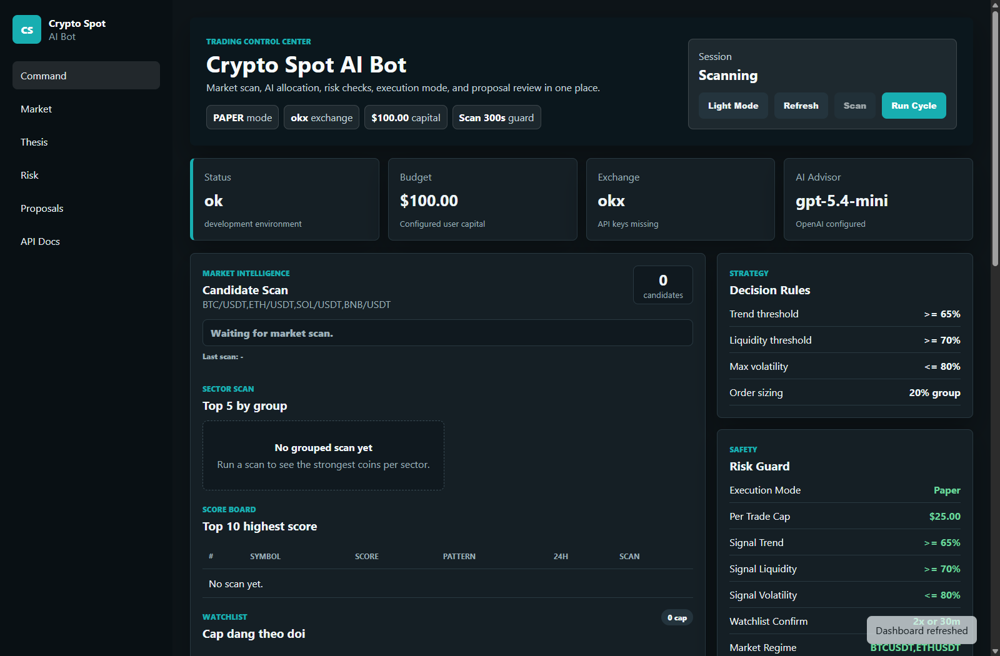
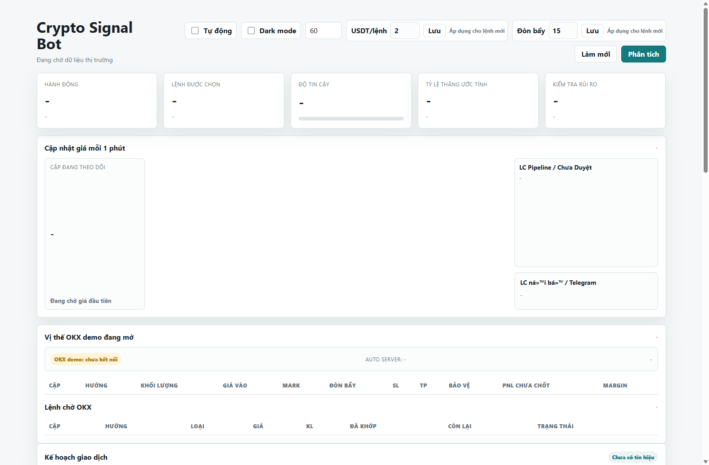
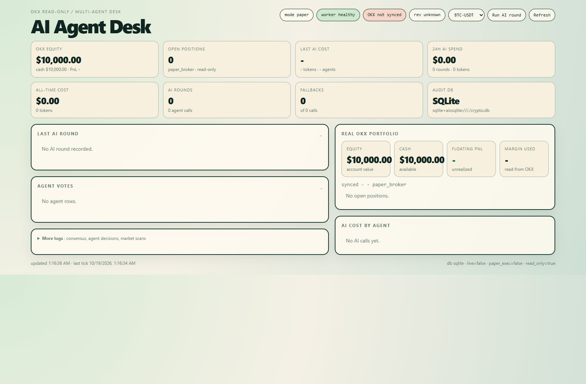
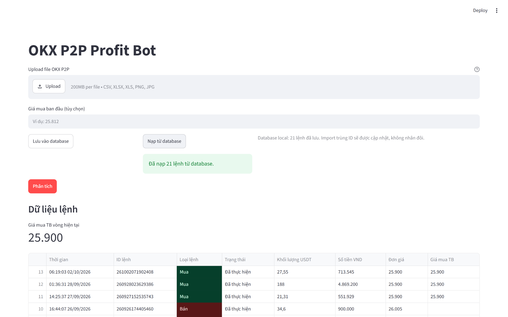

# 🚀 Hệ Thống Giao Dịch Tự Động Đa Thị Trường & Quản Lý Lợi Nhuận (Crypto, Forex & P2P Ecosystem)

Chào mừng bạn đến với hệ sinh thái định lượng, trí tuệ nhân tạo (AI) và kế toán giao dịch toàn diện. Dự án quy tụ **5 hệ thống bot chuyên biệt** được thiết kế bài bản cho từng phân khúc thị trường tài chính: **Crypto Spot**, **Crypto Futures**, **Gold & Forex (XAUUSD)**, **Multi-Agent Signal Intelligence**, và **OKX P2P Merchant Arbitrage ("Trade U")**.

Mỗi dự án hoạt động độc lập, sở hữu kiến trúc module riêng biệt, bảng điều khiển giám sát trực quan (**Web Dashboard UI**), hệ thống chốt chặn rủi ro đa tầng (**Risk Guards**) và cơ chế chuyển đổi linh hoạt giữa các chế độ **Paper/Demo**, **Live Execution**, hoặc **P2P Accounting**.

---

## 📊 Bảng So Sánh Chi Tiết 5 Hệ Thống Bot

| Tiêu Chí | 🟢 bot_spot | 🟡 bot-FX / xauusd-trading-bot | 🔵 Crypto_Bunny | 🟣 Future_V2 | 🟠 OKX-P2P-Profit-Bot ("Trade U") |
| :--- | :--- | :--- | :--- | :--- | :--- |
| **Thị Trường Mục Tiêu** | Crypto Spot (Giao ngay) | Vàng (XAUUSD) & Ngoại hối (Forex) | Crypto Spot & Signal Đa coin | Crypto Futures (Phái sinh) & Spot | P2P Arbitrage & Thương nhân USDT/VND |
| **Sàn Giao Dịch / Broker** | OKX (hỗ trợ Binance/Bybit qua CCXT) | MetaTrader 5 (MT5 Desktop Terminal) | OKX (REST V5 & WebSocket) | OKX (REST V5 & CCXT) | Sàn OKX (P2P Merchant Desk) |
| **Phương Pháp Ra Quyết Định** | AI Market Thesis + Rule Engine định lượng | Thuần Định Lượng (100% Rule-Based, Zero AI) | Multi-Agent Consensus + Market Pattern | Multi-Agent Desk (AI đề xuất, Risk quyết định) | Thuật toán FIFO & Rolling Cost Basis cuốn chiếu |
| **Mô Hình AI / Chỉ Báo** | GPT-5.4-mini / GPT-4o-mini / Fallback | EMA (50/200), RSI, ATR, ADX, MACD | Pattern Engine, LC Pipeline, Volatility Scout | Technical, Momentum, Sentiment, Risk Agents | Tesseract OCR Computer Vision (vie + eng) |
| **Cơ Chế Quản Trị Rủi Ro** | Max allocation/nhóm, Volatility & Liquidity filter | Dynamic Lot theo Equity/Tick, Basket SL/TP, Max Spread | Account Recovery, Đòn bẩy động, SL/TP linh hoạt | Deterministic Risk Guard, Emergency Kill Switch | Cảnh báo bán trước mua, lọc lệnh hủy, đối soát khớp lệnh |
| **Giao Diện Điều Hành (UI)** | Spot AI Web Dashboard | XAUUSD Dark-Themed Operator Dashboard | Advanced Operator UI with Strategy Config | Futures Operator Dashboard & Consensus Matrix | Streamlit Interactive P2P Profit Dashboard |
| **Cổng Web UI Mặc Định** | Port 8000 (FastAPI UI) | Port 8000 (/dashboard) | Port 8013 (Operator UI) | Port 8014 (/dashboard) | Port 8501 (Streamlit App) |
| **Cơ Sở Dữ Liệu / Cache** | MongoDB Atlas, In-memory state | SQLite / In-memory, MT5 Local History | Local Cache / JSON Reports / SQLite | PostgreSQL, Redis, Docker Compose | SQLite (okx_p2p_orders.db), Snapshot Backups |
| **Chế Độ Giao Dịch** | Paper Simulation / Live Guardrail | Paper Broker / MT5 Demo / MT5 Live | Dry-run / OKX Demo / OKX Live | Paper Worker Loop / Live Gatekeeper | Quản lý sổ cái, Đối soát OCR, Tính PnL Real-time |
| **Trạng Thái Vận Hành** | Sẵn sàng hoạt động | Sẵn sàng hoạt động | Sẵn sàng hoạt động | Sẵn sàng hoạt động | Sẵn sàng hoạt động |

---

## 🏛️ Sơ Đồ Cấu Trúc Toàn Bộ Dự Án

```text
C:\Users\Admin\Documents\crypto
├── 📁 bot_spot/                     # [1] Bot Crypto Spot AI (CCXT/OKX + AI Thesis)
│   ├── docs/images/dashboard.png   #     Ảnh chụp giao diện Web UI
│   ├── spot_ai_bot/                #     Mã nguồn: API, Collector, Strategy, Risk, Execution
│   └── README.md                   #     Tài liệu chi tiết bot_spot
│
├── 📁 bot-FX/                       # [2] Bot Vàng XAUUSD & Forex (MetaTrader 5)
│   ├── README.md                   #     Điều hướng dự án FX
│   └── xauusd-trading-bot/         #     Dự án bot XAUUSD chính
│       ├── docs/images/dashboard.png # Ảnh chụp giao diện Web UI
│       ├── app/                    #     Mã nguồn: MT5 Broker, Strategy, Risk, Basket, Guards
│       └── README.md               #     Tài liệu chi tiết XAUUSD Bot
│
├── 📁 Crypto_Bunny/                 # [3] Bot Tín Hiệu & Multi-Agent OKX
│   ├── docs/images/dashboard.png   #     Ảnh chụp giao diện Web UI
│   ├── crypto_trader/              #     Mã nguồn: CLI, Agents, Web UI, OKX Gateway
│   ├── market_pattern_engine/      #     Module nhận diện mô hình thị trường độc lập
│   └── README.md                   #     Tài liệu chi tiết Crypto_Bunny
│
├── 📁 Future_V2/                    # [4] Bot Crypto Phái Sinh / Futures
│   ├── docs/images/dashboard.png   #     Ảnh chụp giao diện Web UI
│   ├── app/                        #     Mã nguồn: Multi-Agent Desk, Risk Guard, API, Worker
│   └── README.md                   #     Tài liệu chi tiết Future_V2
│
└── 📁 OKX-P2P-Profit-Bot/           # [5] Bot Quản Lý Chênh Lệch & Kế Toán P2P ("Trade U")
    ├── docs/images/dashboard.png   #     Ảnh chụp giao diện Web UI
    ├── okx_p2p_bot/                #     Mã nguồn: Calculator, OCR, CSV Importer, SQLite Storage
    ├── tessdata/                   #     Dữ liệu huấn luyện OCR tiếng Việt và tiếng Anh
    ├── app.py                      #     Streamlit Dashboard tương tác
    └── README.md                   #     Tài liệu chi tiết OKX-P2P-Profit-Bot
```

---

## 🖼️ Bộ Sưu Tập Giao Diện Điều Hành (Operator Dashboards)

### 1. bot_spot — Crypto Spot AI Dashboard
Giao diện kết nối sàn OKX, quét thị trường tự động, phân tích luận điểm AI GPT và kiểm soát rủi ro phân bổ vốn.


### 2. bot-FX / xauusd-trading-bot — XAUUSD & Forex Trading Dashboard
Giao diện Dark Theme kết nối MetaTrader 5, ma trận chỉ báo kỹ thuật thời gian thực (EMA, RSI, ATR, ADX), quản lý Basket lệnh và audit log.


### 3. Crypto_Bunny — Advanced Multi-Agent Signal & Trader Dashboard
Bảng điều khiển tương tác cao trên cổng 8013, tinh chỉnh cấu hình chiến lược trực tiếp, giám sát vị thế OKX và feed quyết định AI.


### 4. Future_V2 — Crypto Futures Multi-Agent Desk Dashboard
Bàn điều hành tác tử giao dịch phái sinh trên cổng 8014, tích hợp Paper loop chu kỳ 15m/1H, Multi-agent Consensus và nút ngắt khẩn cấp Kill Switch.


### 5. OKX-P2P-Profit-Bot ("Trade U") — OKX P2P Merchant Arbitrage Dashboard
Bảng điều hành kế toán và phân tích tỷ suất sinh lời P2P trên cổng 8501, tự động tính giá mua trung bình theo chu kỳ vốn cuốn chiếu, bóc tách hóa đơn OCR, khớp lệnh bán với giá vốn đối ứng và phân tích PnL theo ngày/theo cặp giá chênh lệch.


---

## ⚙️ Hướng Dẫn Cài Đặt & Khởi Động Chung

### 1. Chuẩn Bị Môi Trường
- **Hệ điều hành**: Windows 10/11 64-bit (yêu cầu để chạy MetaTrader 5 cho bot-FX).
- **Python**: Khuyến nghị cài đặt Python 3.11.x (đã kiểm tra tương thích hoàn hảo trên Python 3.11.9).
- **MetaTrader 5 Desktop**: Cài đặt MT5 và đăng nhập tài khoản Demo sàn Forex bất kỳ.
- **Tài khoản OKX**: Chuẩn bị API Key sàn OKX (chỉ cấp quyền Read và Trade, không cấp quyền Rút tiền).
- **OpenAI API Key**: Dành cho tính năng AI Market Thesis (bot_spot và Future_V2).
- **Tesseract OCR**: Dành cho tính năng quét ảnh hóa đơn chuyển khoản của OKX-P2P-Profit-Bot.

### 2. Cổng Web UI Độc Lập
Các hệ thống được cấu hình trên các cổng dịch vụ độc lập, giúp tránh xung đột port khi vận hành đồng thời:

| Bot | Cổng Dịch Vụ | Lệnh Khởi Chạy UI | Đường Dẫn Truy Cập |
| :--- | :--- | :--- | :--- |
| **bot_spot** | Port 8000 | `python -m uvicorn spot_ai_bot.main:app --port 8000` | http://localhost:8000 |
| **bot-FX / xauusd** | Port 8000 *(hoặc đổi port)* | `python -m uvicorn app.main:app --port 8000` | http://127.0.0.1:8000/dashboard |
| **Crypto_Bunny** | Port 8013 | `python -m crypto_trader ui --config config.demo.yaml --port 8013` | http://localhost:8013 |
| **Future_V2** | Port 8014 | `python -m uvicorn app.api.main:app --port 8014` | http://localhost:8014/dashboard |
| **OKX-P2P-Profit-Bot** | Port 8501 | `streamlit run app.py --server.port 8501` | http://localhost:8501 |

---

## 🛡️ Nguyên Tắc Quản Trị Rủi Ro & An Toàn Vốn (Safety First)

1. **Paper-First Execution**: Mọi bot giao dịch thị trường đều mặc định khởi động ở chế độ mô phỏng (PAPER, dry_run, DEMO). Live mode chỉ được kích hoạt khi người vận hành chủ động cấp cờ an toàn rõ ràng.
2. **Deterministic Risk Override**: AI không bao giờ được phép tự ý vào lệnh nếu vi phạm quy tắc rủi ro toán học cố định. Lớp Risk Guard luôn có quyền phủ quyết tuyệt đối.
3. **Emergency Kill Switch**: Nút ngắt tức thì sẵn sàng đóng sạch vị thế và hủy toàn bộ lệnh chờ khi thị trường xảy ra biến động bất thường.
4. **Không Martingale / Grid Nhồi Lỗ**: Tuyệt đối không gấp thếp khối lượng khi vị thế đang âm. Khối lượng vào lệnh luôn tính theo tỷ lệ phần trăm vốn rủi ro hợp lệ.
5. **Giới Hạn Thua Lỗ Hàng Ngày (Max Daily Loss Limit)**: Bot tự động khóa cổng vào lệnh nếu chạm ngưỡng Drawdown cho phép trong ngày.
6. **Kiểm Soát Vòng Vốn P2P (Cycle Inventory Match)**: Với thương nhân P2P, luôn giám sát giá mua trung bình vòng hiện tại để không bán ra dưới giá vốn thực tế.

---

## 📖 Chi Tiết Từng Dự Án (Direct Links)

- 👉 [Xem tài liệu chi tiết bot_spot (Crypto Spot AI)](bot_spot/README.md)
- 👉 [Xem tài liệu chi tiết bot-FX / xauusd-trading-bot (Gold & Forex MT5)](bot-FX/xauusd-trading-bot/README.md)
- 👉 [Xem tài liệu chi tiết Crypto_Bunny (Multi-Agent OKX Signal)](Crypto_Bunny/README.md)
- 👉 [Xem tài liệu chi tiết Future_V2 (Crypto Futures Multi-Agent Desk)](Future_V2/README.md)
- 👉 [Xem tài liệu chi tiết OKX-P2P-Profit-Bot ("Trade U" P2P Merchant Arbitrage)](OKX-P2P-Profit-Bot/README.md)

---

## ⚠️ Tuyên Bố Miễn Trừ Trách Nhiệm (Disclaimer)

*Phần mềm này được xây dựng cho mục đích nghiên cứu, học thuật và thử nghiệm giao dịch thuật toán tự động cũng như kế toán định lượng P2P. Giao dịch tiền mã hóa (Cryptocurrency) và hợp đồng chênh lệch (CFD/Forex/Vàng) tiềm ẩn mức độ rủi ro rất cao đối với nguồn vốn của bạn và có thể dẫn đến việc mất toàn bộ số tiền đầu tư. Người vận hành hoàn toàn tự chịu trách nhiệm đối với mọi quyết định vào lệnh và kết quả tài chính khi kích hoạt chế độ giao dịch thực tế (LIVE mode).*
