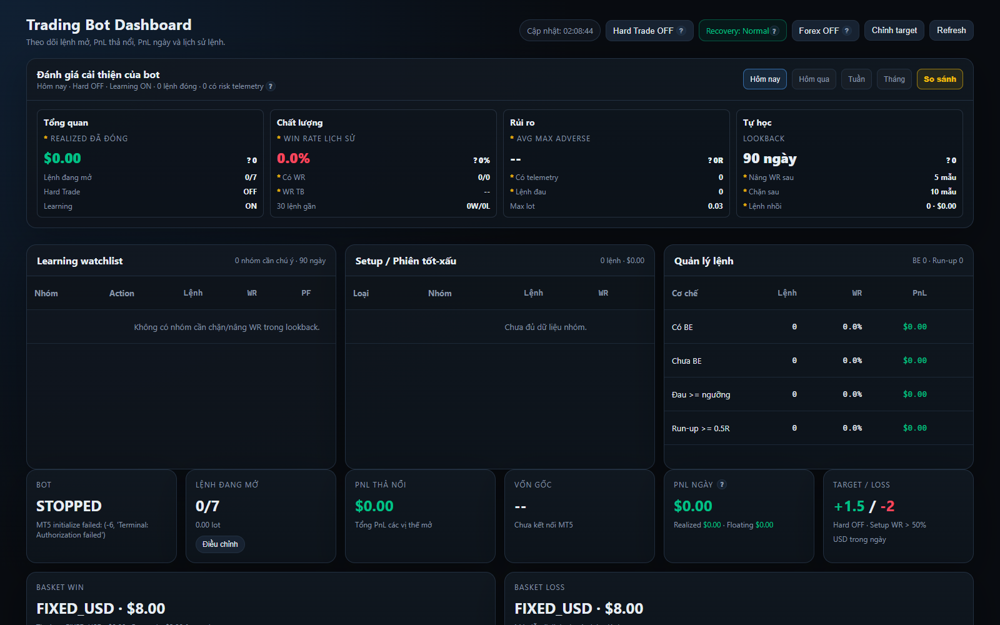

# 🟡 Bot FX: XAUUSD (Gold) & Forex MetaTrader 5 Trading Bot

Hệ thống giao dịch tự động định lượng chuyên biệt cho thị trường **Vàng (XAUUSD)** và **Ngoại hối (Forex)**, kết nối trực tiếp với nền tảng **MetaTrader 5 (MT5) Desktop Terminal**.

Hệ thống sử dụng **động cơ quy tắc xác định 100% (Deterministic Rule-Based Engine)**, dựa trên ma trận chỉ báo kỹ thuật định lượng (EMA, RSI, ATR, ADX, MACD) kết hợp đa tầng phòng hộ rủi ro (Risk Guard), Basket Stop Loss/Take Profit và Web Dashboard điều hành trực quan thời gian thực.

---

## 🖼️ Giao Diện Điều Hành (Operator Web Dashboard)

Bot được tích hợp sẵn giao diện Web Dashboard Dark-Theme thời gian thực được xây dựng trên nền tảng **FastAPI**, cung cấp bức tranh toàn cảnh về thị trường, tài khoản và trạng thái các lệnh:

### Các Tính Năng Nổi Bật Trên Dashboard:
1. **Bảng Chỉ Số Tài Khoản Thời Gian Thực (Financial Metrics)**:
   - **Tài khoản**: Số dư (Balance), Tài sản ròng (Equity), Lợi nhuận trong ngày (Today PnL).
   - **Hiệu suất**: Tỷ lệ thắng (Win Rate), Tổng số lệnh (Total Trades), Ký quỹ khả dụng và Tỷ lệ ký quỹ (Margin Level).
   - **Trạng thái**: Chế độ vận hành (PAPER, DEMO, LIVE), Kết nối MT5 Broker, Tình trạng kích hoạt bot.
2. **Biểu Đồ Giá Vàng Trực Tiếp (Live Gold Price Chart)**:
   - Tích hợp biểu đồ TradingView tương tác cao theo dõi sát diễn biến giá XAUUSD theo thời gian thực.
3. **Ma Trận Tín Hiệu & Chỉ Báo Định Lượng (Real-time Signals)**:
   - **EMA 50 / EMA 200**: Bộ lọc xác định xu hướng thị trường trung và dài hạn.
   - **RSI (14)**: Nhận diện động lượng quá mua (Overbought) và quá bán (Oversold).
   - **ATR (14)**: Đo lường biên độ biến động thực tế để tính toán khoảng cách Stop Loss và Trailing Stop động.
   - **ADX (14)**: Đánh giá độ mạnh của xu hướng nhằm loại bỏ nhiễu khi thị trường đi ngang (Sideway).
   - **MACD**: Xác nhận tín hiệu giao cắt động lượng trước khi kích hoạt lệnh.
4. **Quản Lý Vị Thế & Rổ Lệnh (Open Positions & Baskets)**:
   - Theo dõi từng vị thế mở (Ticket, Symbol, Type, Volume, Open Price, SL, TP, PnL).
   - Quản lý theo cụm rổ lệnh (Basket), cho phép đóng toàn bộ rổ khi đạt mục tiêu lợi nhuận hoặc chạm ngưỡng dừng lỗ tổng.
5. **Trung Tâm Cấu Hình & Can Thiệp Khẩn Cấp (Configuration & Emergency Controls)**:
   - Nút can thiệp nhanh: **Close All Positions** (Đóng toàn bộ vị thế), **Pause/Resume Entry** (Tạm dừng/Tiếp tục vào lệnh mới).
   - Tinh chỉnh tham số rủi ro trực tiếp: Daily Max Loss, Max Drawdown, Basket TP/SL, Hard Trade Limits.

---

## 🛡️ Đa Tầng Quản Trị Rủi Ro (Multi-Layer Risk Guard)

Thị trường Vàng (XAUUSD) có biên độ dao động mạnh và thường xuyên chịu ảnh hưởng từ tin tức kinh tế vĩ mô. Bot FX được trang bị hệ thống quản trị rủi ro nghiêm ngặt:

| Cơ chế | Mô tả chi tiết |
| :--- | :--- |
| **Daily Drawdown Limit** | Tự động ngừng giao dịch trong ngày khi tổng thua lỗ đạt ngưỡng tối đa quy định. |
| **Basket SL & TP** | Bảo vệ rổ lệnh bằng cách chốt lời hoặc cắt lỗ toàn bộ cụm lệnh tương quan. |
| **Dynamic Lot Sizing** | Tính toán khối lượng vào lệnh tự động dựa trên số dư khả dụng (Equity) và giá trị Tick của Vàng. |
| **Max Spread & Slippage Filter** | Chặn vào lệnh khi spread bị giãn mạnh trong thời điểm ra tin tức hoặc phiên giao dịch thanh khoản thấp. |
| **Hard Trade Limit** | Giới hạn số lượng lệnh mở đồng thời và số giao dịch tối đa mỗi ngày để chống over-trading. |
| **Trailing Stop Động (ATR-based)** | Tự động dời Stop Loss theo bước sóng của ATR để bảo toàn lợi nhuận đã đạt được. |

---

## 📂 Cấu Trúc Dự Án

`	ext
bot-FX/
├── docs/
│   └── images/
│       └── dashboard.png           # Ảnh chụp giao diện Dashboard XAUUSD thực tế
├── xauusd-trading-bot/              # Thư mục mã nguồn chính của bot
│   ├── app/
│   │   ├── main.py                 # FastAPI application entrypoint
│   │   ├── runtime.py              # Bot runtime loop & state manager
│   │   ├── routes_dashboard.py     # Endpoint phục vụ giao diện Web Dashboard
│   │   ├── api/                    # REST API routes điều khiển bot
│   │   ├── broker/                 # Module kết nối MetaTrader 5 (MT5 IPC client)
│   │   ├── engine/                 # Động cơ quy tắc xác định & ma trận chỉ báo
│   │   ├── risk/                   # Bộ kiểm soát rủi ro đa tầng (Risk Manager)
│   │   └── storage/                # Lưu trữ cơ sở dữ liệu SQLite/PostgreSQL
│   ├── config/
│   │   └── trading_bot.yaml        # File cấu hình tham số chiến lược và quản lý vốn
│   ├── docs/
│   │   └── images/
│   │       └── dashboard.png       # Ảnh chụp UI dashboard
│   ├── scripts/
│   │   └── run_paper.py            # Script khởi chạy chế độ Paper trading
│   ├── RUN_BOT_DASHBOARD.bat       # File khởi động nhanh Dashboard trên Windows
│   ├── pyproject.toml              # Quản lý dependencies (Poetry / Pip)
│   └── README.md                   # Tài liệu chi tiết nội bộ dự án
└── README.md                       # Tài liệu tổng quan bot-FX (file này)
`

---

## 🚀 Hướng Dẫn Cài Đặt & Vận Hành

### 1. Yêu Cầu Môi Trường
- **Hệ điều hành**: Windows 10/11 64-bit (bắt buộc để chạy MetaTrader 5 Desktop Terminal).
- **Python**: Phiên bản 3.11 trở lên.
- **MetaTrader 5**: Đã cài đặt MT5 Desktop Terminal và mở tài khoản Demo hoặc Real.

### 2. Cài Đặt Thư Viện

`powershell
cd C:\Users\Admin\Documents\crypto\bot-FX\xauusd-trading-bot
python -m pip install -e .
`

### 3. Cấu Hình Biến Môi Trường

Tạo file .env từ file mẫu .env.example:

`ash
TRADING_MODE=PAPER                  # PAPER, DEMO, hoặc LIVE
BROKER_STARTUP_ENABLED=false        # Đặt true khi kết nối MT5 thật
MT5_LOGIN=your_account_number
MT5_PASSWORD=your_password
MT5_SERVER=your_broker_server
DATABASE_URL=sqlite:///data/trading_bot.db
API_HOST=127.0.0.1
API_PORT=8000
`

### 4. Khởi Chạy Web Dashboard

Cách 1: Chạy file batch tự động:
`powershell
.\RUN_BOT_DASHBOARD.bat
`

Cách 2: Chạy trực tiếp bằng Python:
`powershell
cd C:\Users\Admin\Documents\crypto\bot-FX\xauusd-trading-bot
python -m uvicorn app.main:app --host 127.0.0.1 --port 8000
`

Truy cập giao diện điều hành tại: **http://127.0.0.1:8000/dashboard**

---

## 🔗 Liên Kết Liên Quan
- [Tài liệu chi tiết nội bộ xauusd-trading-bot](xauusd-trading-bot/README.md)
- [README tổng quan toàn bộ hệ thống](../README.md)
