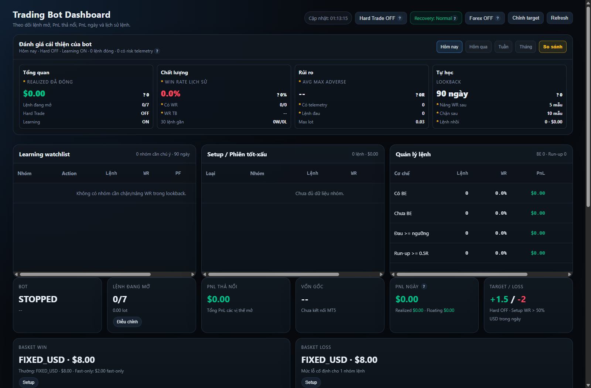

# 🟡 XAUUSD & Forex Quantitative Trading Bot

Hệ thống giao dịch tự động định lượng chuyên biệt cho thị trường **Vàng (XAUUSD)** và **Ngoại hối (Forex)**, kết nối trực tiếp với nền tảng **MetaTrader 5 (MT5)**. Toàn bộ logic ra quyết định của bot là **động cơ quy tắc xác định 100% (Deterministic Rule-Based Engine)**, tuyệt đối không sử dụng mô hình AI hộp đen, LLM hoặc API dự đoán xác suất, đảm bảo tính minh bạch, nhất quán và an toàn vốn tuyệt đối.

> ⚠️ **Cảnh báo rủi ro**: Thị trường Vàng (XAUUSD) có biên độ biến động rất mạnh, thường xuyên xảy ra giãn spread, trượt giá (slippage) và khoảng trống giá (gap) khi có tin tức kinh tế vĩ mô. Phần mềm này không đảm bảo sinh lời. Luôn bắt đầu từ chế độ **PAPER**, chuyển qua tài khoản **DEMO** trước khi cân nhắc bất kỳ giao dịch bằng tiền thật (**LIVE**).

---

## 🖼️ Giao Diện Điều Hành (Operator Web Dashboard)

Bot được tích hợp sẵn giao diện Dark-Theme hiện đại xây dựng trên nền tảng **FastAPI**, cung cấp khả năng quan sát toàn diện và kiểm soát vận hành theo thời gian thực:

### Các Phân Khu Chức Năng Trên Giao Diện:
1. **System Health & Account Metric Bar**:
   - **Trading Mode**: Hiển thị chế độ hiện tại (PAPER, DEMO, LIVE). Mặc định an toàn là PAPER.
   - **MT5 Connection**: Trạng thái kết nối trực tiếp với ứng dụng MetaTrader 5 Desktop Terminal (Broker Ping, Login ID, Server).
   - **Financial Metrics**: Giám sát tức thời Số dư tài khoản (Balance), Tài sản ròng (Equity), Ký quỹ khả dụng (Free Margin) và Tỷ lệ ký quỹ (Margin Level).
2. **Real-time Indicator Matrix (Ma trận chỉ báo kỹ thuật thời gian thực)**:
   - **EMA 50 / EMA 200**: Xác định xu hướng trung - dài hạn trên các khung thời gian H4, H1 và M15.
   - **RSI (14)**: Đo lường động lượng và vùng quá mua/quá bán (Overbought/Oversold).
   - **ATR (14)**: Đo lường biên độ biến động thực tế (Average True Range), làm căn cứ tính toán khoảng cách Stop Loss và Trailing Stop động.
   - **ADX (14)**: Đánh giá sức mạnh xu hướng thị trường (chỉ mở lệnh khi ADX > ngưỡng tiêu chuẩn, tránh thị trường đi ngang/sideway rủi ro cao).
   - **MACD**: Xác nhận xung lực nến và điểm đảo chiều sớm.
3. **Active Positions & Basket Management (Quản trị vị thế & rổ lệnh)**:
   - Theo dõi từng lệnh đang mở: Mã lệnh (Ticket), Chiều (BUY/SELL), Khối lượng (Lot Size), Giá vào (Entry Price), Giá hiện tại (Current Price), Lãi/Lỗ hiện tại (Floating PnL).
   - Trạng thái các tính năng bảo vệ lệnh: **Break-Even** (dời SL về hòa vốn), **Trailing Stop ATR**, và **Partial Close** (chốt lời từng phần).
4. **Audit Trail & Trade Event Log**:
   - Ghi lại chi tiết từng quyết định của bot: Thời điểm đóng nến M5, điểm số kỹ thuật (Signal Score từ 0 - 100), lý do chấp nhận hoặc lý do các chốt chặn (Guards) từ chối lệnh.

---

## 🚀 Các Tính Năng Cốt Lõi (Core Features)

### 1. Multi-Timeframe Signal Engine (Động Cơ Tín Hiệu Đa Khung Thời Gian)
- **Khung H4 & H1**: Xác định xu hướng chủ đạo (Regime Trend) thông qua cấu trúc giao cắt EMA 50/200 và cấu trúc đỉnh/đáy cao dần (HH-HL) hoặc thấp dần (LH-LL).
- **Khung M15**: Nhận diện nhịp hồi quy kỹ thuật (Pullback) về các vùng hỗ trợ/kháng cự động (vùng giá trị giữa EMA 50 và EMA 200).
- **Khung M5**: Đợi nến tín hiệu xác nhận (Bullish/Bearish Engulfing, Hammer, Rejection Pinbar) để tối ưu điểm vào lệnh với tỷ lệ R:R cao nhất.
- Chấm điểm tín hiệu tổng hợp từ 0 đến 100 điểm. Lệnh chỉ được phép cân nhắc khi điểm số vượt ngưỡng chuẩn khắt khe (mặc định >= 75 điểm).

### 2. Quản Trị Vốn Động (Dynamic Position Sizing & Lot Calculation)
- **Không Martingale**: Tuyệt đối không nhồi lệnh gấp thếp khối lượng khi đang thua lỗ.
- Khối lượng lệnh (Lot size) được tính toán tự động dựa trên:
  - Tỷ lệ phần trăm rủi ro trên vốn ròng (
isk_percent_per_trade, mặc định 1.0% - 1.5% Equity).
  - Khoảng cách Stop Loss theo bội số của biến động ATR thực tế.
  - Thông số kỹ thuật hợp đồng broker: Kích thước bước giá (	rade_tick_size) và giá trị bước giá (	rade_tick_value) lấy trực tiếp từ MT5 API.

### 3. Quản Lý Basket & Bảo Vệ Lệnh Chủ Động
- **Break-Even Protection**: Tự động dời Stop Loss về điểm vào lệnh (kèm thêm 1-2 pips bù phí spread) ngay khi lệnh đạt tỷ lệ lợi nhuận R:R 1:1.
- **Dynamic Trailing Stop**: Dời điểm dừng lỗ bám sát giá theo bước sóng ATR khi thị trường hình thành xu hướng mạnh, bảo toàn tối đa lợi nhuận tích lũy.
- **Partial Close (Chốt lời từng phần)**: Tự động chốt 50% khối lượng khi chạm mục tiêu TP1, giữ 50% còn lại để gồng lãi theo xu hướng dài.
- **Scale-in An Toàn**: Chỉ cho phép nhồi thêm vị thế mới khi lệnh trước đó đã có lãi, khoảng cách đủ xa và tổng rủi ro của rổ lệnh nằm trong giới hạn cho phép.

### 4. Hệ Thống Chốt Chặn Rủi Ro Đa Tầng (Guard System)
- **Spread Guard**: Từ chối vào lệnh nếu độ chênh lệch giá (Spread) vượt quá ngưỡng an toàn (ví dụ: > 35 points đối với Vàng trong thời gian giao phiên).
- **Session Guard**: Giới hạn khung giờ giao dịch trong các phiên sôi động có thanh khoản cao (phiên London và đầu phiên New York); tự động né các khung giờ thanh khoản mỏng hoặc rạng sáng.
- **Daily Drawdown Limit**: Khóa hoàn toàn chức năng vào lệnh mới nếu tổng mức sụt giảm trong ngày vượt quá giới hạn thiết lập (ví dụ: tối đa 3% - 5% vốn/ngày).
- **Margin & Free Margin Guard**: Ngăn chặn tình trạng quá tải đòn bẩy; từ chối mở lệnh nếu tỷ lệ ký quỹ tự do không đạt ngưỡng tối thiểu.
- **Cooldown & Duplicate Guards**: Ngăn chặn hiện tượng gửi lệnh lặp hoặc mở lệnh quá dồn dập sau một vị thế vừa đóng.

### 5. Kiến Trúc Hai Vòng Lặp Độc Lập (Dual-Loop Architecture)
- **Signal Loop (Vòng lặp tìm tín hiệu)**: Chạy theo chu kỳ đóng nến M5 để phân tích kỹ thuật và phát hiện cơ hội.
- **Position Management Loop (Vòng lặp quản lý vị thế)**: Chạy liên tục tần số cao (mỗi 1 - 2 giây) độc lập hoàn toàn với Signal Loop. Dù Signal Loop bị khóa hoặc không có tín hiệu, các vị thế đang mở vẫn được giám sát chặt chẽ để dời SL, Trailing Stop và cắt lỗ khẩn cấp.

### 6. Backtest Engine Tích Hợp (Không Look-Ahead Bias)
- Mô phỏng kiểm thử chiến lược trên dữ liệu lịch sử tick và nến chính xác của broker.
- Cơ chế khớp lệnh ở giá mở nến tiếp theo (**Next-Bar Open**), loại trừ hoàn toàn lỗi thiên vị tương lai (look-ahead bias).
- Mô phỏng đầy đủ chi phí giao dịch thực tế: Phí hoa hồng (Commission), chênh lệch giá (Spread) và độ trượt giá ngẫu nhiên (Slippage).

---

## 🏛️ Cấu Trúc Thư Mục Dự Án

`	ext
bot-FX/xauusd-trading-bot/
├── app/
│   ├── api/                    # FastAPI routes (Dashboard, Control, Positions, Status)
│   ├── backtest/               # Backtest Engine, mô phỏng thị trường và xuất báo cáo
│   ├── broker/                 # MT5 Client adapter, Paper Client, Symbol Resolver
│   ├── config/                 # trading_config.yaml, trading_config_gold.yaml, Pydantic settings
│   ├── guards/                 # Spread, Session, Cooldown, Duplicate Order Guards
│   ├── market_data/            # Candle Provider, Tick Provider, Indicator Services
│   ├── models/                 # Basket, Bot State, Event Log, Trade SQLAlchemy models
│   ├── positions/              # Basket Manager, Break-even, Trailing Stop, Partial Close
│   ├── repositories/           # Tương tác cơ sở dữ liệu SQLite / SQLAlchemy
│   ├── risk/                   # Daily Risk Guard, Margin Guard, Dynamic Sizing
│   ├── services/               # Trading Orchestrator, Recovery, Health Service
│   ├── strategy/               # Multi-timeframe Signal Engine, Trend Detector, Candlestick Patterns
│   ├── utils/                  # Tiện ích toán học, chuẩn hóa thời gian
│   └── database.py             # Quản lý kết nối cơ sở dữ liệu SQLite
├── data/
│   └── trading_bot.db          # Cơ sở dữ liệu SQLite lưu trữ trạng thái bot
├── docs/
│   └── images/
│       └── dashboard.png       # Ảnh chụp Web UI Dashboard
├── logs/                       # Nhật ký chi tiết: trading.log, risk.log, execution.log
├── migrations/                 # Alembic database migrations
├── RUN_BOT_DASHBOARD.bat       # Script khởi động bot kèm Web Dashboard trên Windows
├── STOP_BOT_DASHBOARD.bat      # Script dừng nhanh tiến trình bot
├── requirements.txt            # Danh sách thư viện Python (MetaTrader5, FastAPI, Pydantic...)
└── README.md                   # Tài liệu chi tiết dự án
`

---

## ⚙️ Hướng Dẫn Cài Đặt & Cấu Hình

### 1. Yêu Cầu Môi Trường
- **Hệ điều hành**: Windows 10/11 64-bit (bắt buộc cho thư viện MetaTrader5).
- **Phần mềm MetaTrader 5**: Cài đặt bản MT5 Desktop từ broker của bạn (Exness, IC Markets, Tickmill, FTMO, v.v.).
- **Python**: Khuyến nghị Python 3.11.x (3.11.9).

### 2. Thiết Lập Môi Trường Ảo
`powershell
cd C:\Users\Admin\Documents\crypto\bot-FX\xauusd-trading-bot
python -m venv .venv
.\.venv\Scripts\Activate.ps1
pip install -r requirements.txt
`

### 3. Cấu Hình Tài Khoản MT5 (.env)
Tạo file .env từ .env.example:

`ini
# MetaTrader 5 Credentials
MT5_PATH=C:\Program Files\MetaTrader 5\terminal64.exe
MT5_LOGIN=12345678
MT5_PASSWORD=your_mt5_password
MT5_SERVER=ICMarkets-Demo

# Chế độ vận hành: PAPER, DEMO, hoặc LIVE
TRADING_MODE=PAPER
REQUIRE_DEMO_ACCOUNT=true
ENABLE_LIVE_TRADING=false

# Cấu hình API Server
PORT=8000
HOST=127.0.0.1
`

### 4. Tùy Chỉnh Chiến Lược (app/config/trading_config.yaml)
Trong file cấu hình, bạn có thể tinh chỉnh:
- symbol: Tên cặp Vàng trên sàn của bạn (XAUUSD, GOLD, XAUUSDm...).
- 
isk.max_risk_per_trade_percent: % rủi ro mỗi lệnh (khuyến nghị 1.0%).
- 
isk.daily_max_loss_percent: Giới hạn sụt giảm tài khoản trong ngày (khuyến nghị 3.0%).
- indicators.ema_fast, ma_slow: Chu kỳ EMA (50 và 200).
- 	railing_stop.activation_rr: Tỷ lệ R:R để kích hoạt Trailing Stop.

---

## 🚦 Hướng Dẫn Vận Hành

### Cách 1: Sử Dụng File Batch Tiện Ích (Khuyến nghị trên Windows)
- **Khởi động**: Nhấp đúp vào RUN_BOT_DASHBOARD.bat.
- **Dừng bot**: Nhấp đúp vào STOP_BOT_DASHBOARD.bat.

### Cách 2: Chạy Bằng Lệnh PowerShell
`powershell
cd C:\Users\Admin\Documents\crypto\bot-FX\xauusd-trading-bot
.\.venv\Scripts\Activate.ps1
python -m uvicorn app.api.main:app --host 127.0.0.1 --port 8000 --reload
`

Sau khi khởi động, truy cập trình duyệt tại địa chỉ:
- **Operator Dashboard**: http://127.0.0.1:8000/dashboard
- **Swagger API Docs**: http://127.0.0.1:8000/docs

---

## 🛡️ Nguyên Tắc Chuyển Sang Tài Khoản Thật (Live Gatekeeper)
Hệ thống tích hợp chốt chặn an toàn REQUIRE_DEMO_ACCOUNT=true theo mặc định. Nếu bạn cố tình kích hoạt TRADING_MODE=LIVE nhưng tài khoản đăng nhập trên MT5 vẫn là tài khoản thật mà chưa tắt cờ này, bot sẽ từ chối gửi lệnh để bảo vệ vốn của bạn. Chỉ chuyển sang Live khi đã hoàn thành tối thiểu 100 lệnh giao dịch mô phỏng có lãi trên tài khoản Demo.\n